# Spawnfile

> Your AI team, compiled. Declare it once, run it in Docker on the subscriptions you already have.

<p align="center">
  <a href="https://www.npmjs.com/package/spawnfile"></a>
  <a href="https://github.com/noopolis/spawnfile/actions/workflows/test.yml"></a>
  <a href="https://github.com/noopolis/spawnfile/blob/main/LICENSE"></a>
  <a href="https://www.npmjs.com/package/spawnfile"></a>
  <a href="https://spawnfile.com"></a>
</p>

<p align="center">
  
</p>

Spawnfile is Compose for agent teams. Declare who your agents are, what they use, when they wake and where they talk, in Markdown and a little YAML. Spawnfile compiles that source into each harness's native configuration, runs the whole team in Docker, and can train its agents in place.

## Try it

Requires **Node.js 22.19+**. Compiling needs no Docker and no credentials.

```bash
npm install -g spawnfile
spawnfile init my-team --template moltnet-team-chat
cd my-team
spawnfile validate
spawnfile compile
```

`compile` writes each agent's runtime configuration, workspace and container files into `.spawn/`. Read `.spawn/spawnfile-report.json` to see how every feature carried over: **supported**, **degraded** or **unsupported**. Nothing is running yet.

Run `spawnfile init --list-templates` for other starting points, or `spawnfile init my-agent` for a single agent.

## Run it

With Docker available:

```bash
spawnfile auth import codex            # or: spawnfile auth import claude-code
spawnfile up . --detach                # compile, build and start the team
spawnfile status . --live              # check the running deployment
```

`up` starts every agent and the team's [Moltnet](https://moltnet.dev) network. A Docker context can point at another machine. Credentials live in local auth profiles, never in the source; see [Docker packaging](https://spawnfile.com/guides/docker/).

## What a Spawnfile declares

A team is a directory with its own `Spawnfile` that references member agents:

```yaml
spawnfile_version: "0.1"
kind: team
name: research-desk
mode: hierarchical
lead: lead
members:
  - { id: lead, ref: ./agents/lead }
  - { id: researcher, ref: ./agents/researcher }
  - { id: writer, ref: ./agents/writer }
networks:
  - id: desk
    provider: moltnet
    rooms:
      - { id: general, members: [lead, researcher, writer] }
```

- **Identity:** SOUL, IDENTITY and AGENTS docs for each agent.
- **Skills and MCP:** shared or per agent.
- **Model:** provider, model and which login it uses.
- **Schedules:** when each agent wakes, and with what prompt.
- **Rooms:** Moltnet networks, rooms, and who wakes on mentions.
- **Nested teams:** teams inside teams, with a lead and shared resources.
- **Memory:** scoped stores and who can read them.
- **Secrets:** which ones are required, never their values.

The [team guide](https://spawnfile.com/guides/teams/) and [examples](https://github.com/noopolis/spawnfile/tree/main/examples) show complete projects.

## Harnesses and models

| Harness | Models | Logins |
|---|---|---|
| **OpenClaw** | OpenAI, Anthropic, custom or local endpoints | ChatGPT or Claude subscription, API key |
| **PicoClaw** | OpenAI, Anthropic, custom or local endpoints | ChatGPT or Claude subscription, API key |
| **Daimon** | Codex, Grok and Antigravity engines | ChatGPT, Grok or Antigravity subscription |
| *More coming soon* | Hermes Agent and OpenCode are in research. | [Request a harness](https://github.com/noopolis/spawnfile/issues) |

Pick a harness per agent and mix them in one team. Exact versions are pinned in [runtimes.yaml](https://github.com/noopolis/spawnfile/blob/main/runtimes.yaml); the full support matrix is in the [runtime specification](https://github.com/noopolis/spawnfile/blob/main/specs/RUNTIMES.md).

## Train it

`spawnfile train` improves one agent's prompt docs against your own train and test cases. Every trial boots your real organization the way production does, judges score the result, and the optimizer rewrites only the files you mark editable.

```bash
spawnfile train ./Spawnfile --agent writer \
  --train evals/train.spawnfile-training.yaml \
  --test evals/test.spawnfile-training.yaml \
  --editable agents/writer/AGENTS.md --dry-run
```

`--dry-run` estimates the cost first; `--resume` continues a stopped run. Trials can start from recorded moments of real turns. Training covers Daimon agents on the Codex and Grok engines today. See the [training guide](https://spawnfile.com/guides/training/).

## Share it

`spawnfile publish` packages the project as an OCI image that another operator runs with their own logins, without the source. See [distribution](https://spawnfile.com/guides/distribution/).

## Go further

| I want to... | Read |
|---|---|
| Start from zero | [Quickstart](https://spawnfile.com/quickstart/) |
| Understand the source format | [Specification](https://github.com/noopolis/spawnfile/blob/main/specs/SPEC.md) |
| Explore complete projects | [Examples](https://github.com/noopolis/spawnfile/tree/main/examples) |
| Integrate with deployment tooling | [Target and lifecycle contracts](https://github.com/noopolis/spawnfile/blob/main/specs/TARGETS.md) |
| Add a harness or contribute | [Contributing](https://github.com/noopolis/spawnfile/blob/main/CONTRIBUTING.md) |

Spawnfile is part of [Noopolis](https://github.com/noopolis): [Moltnet](https://moltnet.dev) carries messages between agents, [Daimon](https://github.com/noopolis/daimon-harness) runs one agent on a subscription engine, and [Simfile](https://simfile.org) builds worlds around a team. Spawnfile works on its own.

## License

[MIT](https://github.com/noopolis/spawnfile/blob/main/LICENSE)

---

**[spawnfile.com](https://spawnfile.com)** · **[Docs](https://spawnfile.com/introduction/)** · **[Examples](https://github.com/noopolis/spawnfile/tree/main/examples)** · **[npm](https://www.npmjs.com/package/spawnfile)**
